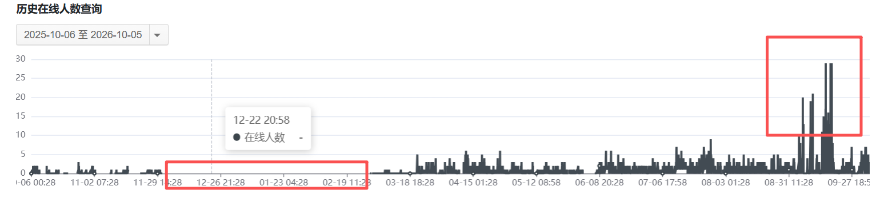

# RedStarMC 2026 社区年刊

今天是红星我的世界社区成立 4 周年纪念日，在此祝各位玩家 4 周年快乐！  
在此，社区管理组组织编写了年刊以供大家阅读。<!--truncate-->

## 年度发展概述

### 服务器及玩法

开设了新玩法插件生存服务器，主版本为 1.21.11，包含宏伟地形、酿酒系统、更多附魔、职业、钓鱼等玩法。  
地狱维度添加了许多新结构以及配套的 Boss、战利品。  
末地维度使用了原创插件，功能包括：末影龙定时复活、每次都生成龙蛋等新机制。并且加强了龙蛋的实用性。

称号系统已经基本完成，待称号库和获取方法确定后将会对各位玩家开放。

### 在线人数及宣传

从 2025 年 10 月 6 日以来的一年来看，整体在线人数仍然处于一个较低的程度。  
其中，寒假由于技术原因并未记录，实际在线人数在五人左右。暑假的人数也并未得到大幅提升。暑期后出现的较大人数突变是网络攻击所致。

这在一定程度上反应了社区在宣传方面的问题存在短板。  
宣传片列表：

* [`什么叫腐竹开个光影就成宣传片`](https://www.bilibili.com/video/BV16jNA6oErr/?share_source=copy_web&vd_source=0c579ca481e99907fda9d05eb4ec333b)
* [`“我们记录了漫长的日落，也在等待偶然路过的你。”`](https://www.bilibili.com/video/BV1RmKJ6YEJZ/?share_source=copy_web&vd_source=0c579ca481e99907fda9d05eb4ec333b)
* [`pvp玩家要给你露一手belike:`](https://www.bilibili.com/video/BV1dz356wEMG/?share_source=copy_web&vd_source=0c579ca481e99907fda9d05eb4ec333b)

### 活动情况

2026 年元旦组织了一次新年活动，并制作了新年地图。活动共有 8 名玩家参与，请见：[2026 新年活动 | 新闻](/news/2026/01/01/-new-year)。

一直以来，社区大力发展主城小游戏。到目前为止主城已建成娱乐中心，除以往的台球、扫雷、2048等小游戏外，还新增了雪球大战和冰船竞速等多人小游戏。

### 维基

累计获得 29 次提交，总计增加 2247，总计减少 1956。

## 图集

[`点击查看： 红星我的世界社区 2026 年度图片展`](https://www.bilibili.com/opus/1255990201372639238)

## 赞助情况

* Suifengsama520 **||**  ¥10
* DARKMATTERZ **||**  ¥20
* waibibabo2009 **||**  ¥50
* NMDHTX **||**  ¥15
* CHI___NIAN **||**  ¥100
* foodbyte **||**  ¥5
* WCPt **||**  ¥50

## 社区人事变动

点击打开折叠项目

2026-6-16:
1. `wenjian` 担任 *第五任* `腐竹`
2. `pingguo` 担任 *第四任* `运维`
3. `WCPt` 担任 `见习管理`
4. `Lier_dog` 卸任 `玩家群群主`

2026-7-2: `WCPt` 担任 `管理` (转正)

2026-7-21: `momo` 担任 `协管`

2026-7-23: `CHI___NIAN` 担任 `实习建筑`

## 下一年发展计划

* 采取不同宣传计划
* 

## 结语

